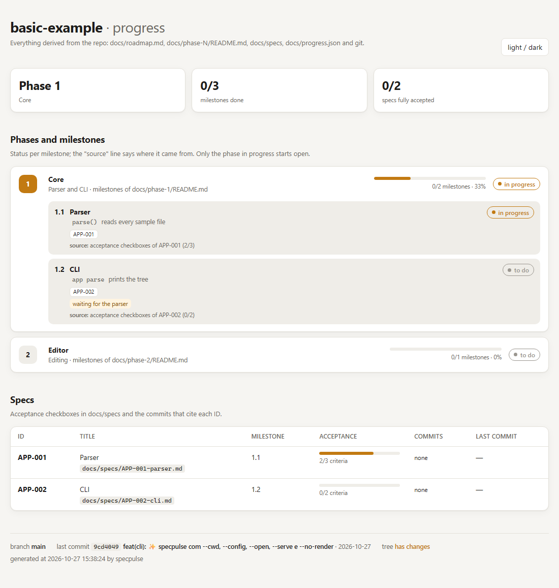

# specpulse

A local, self-contained progress dashboard for spec-driven projects.

specpulse reads what is already in your repository (a roadmap table, per-phase milestone tables,
one markdown file per spec with acceptance checkboxes, your git history and, optionally, a folder
of reference images) and writes a single `index.html` that shows where the project stands. No
server, no account, no network: the page has no external assets and works from `file://`.

It was built for projects where AI agents (Claude Code and friends) do much of the work and you
want to see, at a glance, which milestones are done, which specs still have open acceptance
criteria and which commits touched each spec.



## Status: pre-release

`0.0.0`, not yet published to npm. The CLI, the config format and the data file format may still
change. See [`docs/roadmap.md`](docs/roadmap.md) for what comes next (multi-view layout, live mode
over SSE, Claude Code skill and MCP server).

## Install

Requires Node.js 22.18 or newer.

```sh
pnpm add -D specpulse      # or: npm i -D specpulse
```

Until the first release, link a local checkout instead:

```sh
pnpm add -D link:../specpulse   # after `pnpm build` in the specpulse folder
```

## Usage

```sh
specpulse                       # writes .cache/specpulse/index.html and prints its path
specpulse --open                # ...and opens it in the default browser
specpulse --serve --port 4870   # serves the output folder on http://localhost:4870 (127.0.0.1 only)
specpulse --no-render           # skips the gallery render command
specpulse --cwd ../app --config ./app.specpulse.json
```

| Option            | Meaning                                                                          |
| ----------------- | -------------------------------------------------------------------------------- |
| `--cwd <dir>`     | Project root (default: current directory).                                       |
| `--config <path>` | Config file (default: `specpulse.config.json` or `.specpulse.json` in the root). |
| `--no-render`     | Do not run `gallery.render`.                                                     |
| `--open`          | Open the dashboard in the default browser.                                       |
| `--serve`         | Serve the output folder on `127.0.0.1`.                                          |
| `--port <n>`      | Port for `--serve` (default `4870`).                                             |
| `-v`, `--version` | Print the version.                                                               |
| `-h`, `--help`    | Print the help.                                                                  |

Add the output folder (`.cache/` by default) to your `.gitignore`.

## What it reads

With the defaults, a project looks like this (see [`examples/basic`](examples/basic)):

```
docs/
  roadmap.md            phase table
  phase-1/README.md     milestone table of phase 1
  specs/APP-001-x.md    one spec per file, acceptance criteria as checkboxes
  progress.json         data file (what cannot be derived)
```

**Roadmap.** Every table row whose first cell is a numeric link is a phase:

```md
| Phase                  | Name     | How to test                          | Focus          |
| ---------------------- | -------- | ------------------------------------ | -------------- |
| [1](phase-1/README.md) | **Core** | `app parse file.txt` prints the tree | Parser and CLI |
```

**Phase file.** Every table row whose first cell is `**N.M Name**` is a milestone; the second cell
is the delivery:

```md
| **1.1 Parser** | `parse()` reads every sample file |
```

**Specs.** Files in `specs.dir` whose name starts with an ID matching `specs.idPattern`. The first
heading `# <ID> · Title` (or `:` / `-`) names it; every `- [ ]` / `- [x]` in the file is an
acceptance criterion. Commits whose subject or body cite the ID are listed with the spec.

**Gallery (optional).** Reference images in `gallery.dir`, shown side by side with a fresh render
produced by your own command. Every run with renders keeps a snapshot in `<outDir>/history/`, which
feeds the timeline.

## Config

`specpulse.config.json` in the project root. Every field is optional; the JSON Schema is shipped in
[`schema/config.schema.json`](schema/config.schema.json).

```json
{
  "$schema": "./node_modules/specpulse/schema/config.schema.json",
  "title": "My App",
  "locale": "en",
  "outDir": ".cache/specpulse",
  "dataFile": "docs/progress.json",
  "roadmap": "docs/roadmap.md",
  "phaseFile": "docs/phase-{n}/README.md",
  "specs": { "dir": "docs/specs", "idPattern": "[A-Z]+-\\d{3,}" },
  "gallery": {
    "dir": "tests/golden",
    "sceneExt": ".scene",
    "referenceExt": ".png",
    "render": "my-renderer {scene} -o {out}"
  },
  "timelineLimit": 30
}
```

| Field                  | Default                    | Meaning                                                                    |
| ---------------------- | -------------------------- | -------------------------------------------------------------------------- |
| `title`                | `package.json` name        | Dashboard title.                                                           |
| `locale`               | `en`                       | `en` or `pt-BR`.                                                           |
| `outDir`               | `.cache/specpulse`         | Output folder.                                                             |
| `dataFile`             | `docs/progress.json`       | Data file (below).                                                         |
| `roadmap`              | `docs/roadmap.md`          | Phase table.                                                               |
| `phaseFile`            | `docs/phase-{n}/README.md` | Milestone table per phase; `{n}` is the phase number.                      |
| `specs.dir`            | `docs/specs`               | Spec folder.                                                               |
| `specs.idPattern`      | `[A-Z]+-\d{3,}`            | Regex for spec IDs.                                                        |
| `gallery`              | off                        | Enables the gallery and timeline.                                          |
| `gallery.dir`          | required                   | Reference image folder.                                                    |
| `gallery.referenceExt` | `.png`                     | Reference image extension.                                                 |
| `gallery.sceneExt`     | none                       | When set, each `<name><sceneExt>` is a scene; otherwise each image is one. |
| `gallery.render`       | none                       | Shell command; placeholders `{scene}`, `{out}`, `{name}`.                  |
| `timelineLimit`        | `30`                       | Snapshots shown in the timeline.                                           |

Unknown keys are rejected, so typos fail loudly.

## Data file

Milestone status is never guessed. The data file says, per milestone, either which specs make it up
(progress = checked / total acceptance checkboxes) or a manual status with its source. A milestone
missing from the file is "to do". Schema: [`schema/data.schema.json`](schema/data.schema.json).

```json
{
  "milestones": {
    "0.1": { "status": "done", "source": "docs/phase-0/README.md" },
    "1.1": { "specs": ["APP-001", "APP-002"], "note": "CI not running yet" }
  },
  "images": {
    "home": { "approved": false }
  }
}
```

- `status`: `done`, `in progress` (or `doing`), `todo`. A manual status wins over `specs`.
- `images.<name>.approved: false` shows an "awaiting owner approval" badge in the gallery.
- Portuguese keys and values are accepted too (`marcos`, `goldens`, `fonte`, `nota`, `aprovada`,
  `feito`, `em andamento`, `a fazer`).

Keep it current: when a spec or milestone is done, update the file in the same commit.

## Programmatic API

```ts
import { generate, loadConfig } from "specpulse";

const root = process.cwd();
const { config } = loadConfig(root);
const { index } = generate({ root, config, render: false });
```

The pure building blocks (`parseRoadmap`, `parseMilestones`, `parseSpec`, `parseGitLog`,
`parseDataFile`, `parseConfig`, `buildModel`, `renderHtml`, …) are exported as well.

## Development

```sh
pnpm install
pnpm check     # biome + tsc + vitest
pnpm build     # dist/
node dist/cli.js --cwd examples/basic --open
```

## License

[MIT](LICENSE) © 2026 Leonardo Lima
